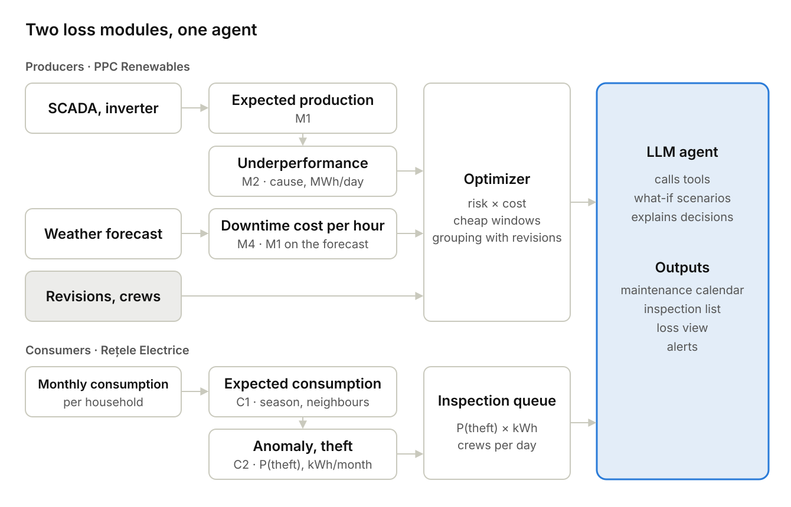

# Energy Loss Agent

**An agent that predicts and reduces energy losses at both ends of the chain: at producers and at consumers.**

Project for **Smarthack XI 2026**, PPC theme *"24h to Power PPC: AI in energy, from data to action"*.

> **Status:** in progress, built one step at a time ([plan](docs/producers-plan.md)). The producers module runs end to end on wind and solar: data ([`src/data/prepare.py`](src/data/prepare.py)), expected production ([`expected_power.py`](src/producers/expected_power.py)), underperformance ([`underperformance.py`](src/producers/underperformance.py), [`inject_faults.py`](src/simulate/inject_faults.py)), downtime cost from the forecast ([`downtime_cost.py`](src/producers/downtime_cost.py)), the maintenance calendar ([`optimizer.py`](src/decision/optimizer.py), [`tests/`](tests/test_optimizer.py)), the one-year backtest ([`backtest.py`](src/decision/backtest.py)) and the solar branch ([`solar.py`](src/producers/solar.py)). This README still describes the target system; the consumers module, LLM agent and dashboard are not built yet.

- **At producers** (wind turbines and PV parks): we estimate how much each piece of equipment should produce. We detect when it produces below normal and schedule revisions and checks in the windows with the lowest loss: low wind for turbines, little sun for panels.
- **At consumers** (households): we estimate how much each household should consume. We detect anomalies in the monthly consumption series (possible theft or a faulty meter) and prioritise inspections.
- **An LLM agent** puts all losses into a single view (MWh and RON), explains each decision and runs what-if scenarios. Decisions come from our models and optimizer, not from the LLM.

---

## Contents

1. [Problem](#1-problem)
2. [Architecture](#2-architecture)
3. [Modules](#3-modules)
4. [Results](#4-results)
5. [Data](#5-data)
6. [Install and run](#6-install-and-run)
7. [Repository structure](#7-repository-structure)
8. [Evaluation](#8-evaluation)
9. [Robustness and explainability](#9-robustness-and-explainability)
10. [Limitations](#10-limitations)
11. [Team](#11-team)
12. [Licences and citations](#12-licences-and-citations)

**Other documents:** [`docs/design.md`](docs/design.md) explains why the system is designed this way. [`CLAUDE.md`](CLAUDE.md) is the build specification.

---

## 1. Problem

Energy losses occur in two places that PPC covers with different divisions:

| Where | What is lost | Why it matters to PPC |
|---|---|---|
| **Production** (PPC Renewables) | Energy not produced when turbines or panels run below potential or are stopped for maintenance at times of high wind or sun | A portfolio of over 1.5 GW in Romania, including the Fântânele-Cogealac wind farm (600 MW, 240 GE 2.5xl turbines) and the Lumina PV park in Călugăreni (63 MW) |
| **Distribution** (Rețele Electrice) | Energy consumed but not billed: theft, faulty meters | A [2018 study](https://www.economica.net/furturile-de-energie-electrica-se-ridica-la-340-de-milioane-de-lei-in-fiecare-an-ce-e-de-facut_158325.html) estimated theft at approx. 3% of the energy entering distribution networks; Rețele Electrice has 2 million smart meters |

The PPC group's [AI programme](https://economedia.ro/georgios-stassis-ppc-vrem-o-cerere-noua-din-partea-centrelor-de-date-dar-trebuie-sa-evitam-ca-ai-sa-mareasca-factura-de-energie-a-clientului-final-corespondenta-eurelectric-power-summit-2.html) explicitly includes predictive maintenance and network loss reduction. Our project puts both problems under one agent, with one unit of measure: energy lost.

---

## 2. Architecture



Three layers, each with its own job:

- **ML models** output physical units with uncertainty (kW, MWh/day, kWh/month, probabilities).
- **The decision layer** (maintenance optimizer, inspection queue) is deterministic and reproducible.
- **The LLM agent** coordinates and explains.

**Principle:** the LLM does not calculate or decide. Every displayed number comes from a tool, and every decision can be traced to the model prediction that produced it.

---

## 3. Modules

### 3.1 Producers: expected production and maintenance planning

| Component | What it does | Algorithm | Baseline |
|---|---|---|---|
| **M1** Expected production | How much the turbine or inverter would produce now, with no problems | Quantile LightGBM (10/50/90%), trained on normal periods only | Power curve on 0.5 m/s bins (wind); rated power × irradiance with temperature correction (PV) |
| **M2** Underperformance | Detects persistent loss, the probable cause and MWh lost per day | 72 h performance index + CUSUM + cause classifier (LightGBM) trained on injected faults | Fixed threshold on the performance index |
| **M3** Failure risk *(optional)* | Probability of failure in the coming days, from abnormal temperatures | Normal-behaviour model on temperatures (CARE to Compare) | Fixed temperature threshold; EnergyFaultDetector (Fraunhofer IEE) |
| **M4** Downtime cost | MWh (or RON) lost if the equipment is stopped in each hour of the next 7–10 days | M1 applied to the weather forecast | – |
| **Optimizer** | Picks the day and crew for each revision and repair | Greedy (optionally CP-SAT) on the cost: downtime + loss while waiting + risk | Policies: "repair immediately", "repair at the next revision" |

Causes detected by M2: yaw misalignment, pitch fault, faulty anemometer, icing (wind); soiling, string outage, shading, derated inverter (PV).

### 3.2 Consumers: anomalies in monthly consumption

| Component | What it does | Algorithm | Baseline |
|---|---|---|---|
| **C1** Expected consumption | How much the household should consume in a month | Quantile LightGBM, from its own history for the same month, trend, similar households, temperature | Median of the same month in previous years × trend factor |
| **C2** Consumption anomaly | Probability of theft, kWh lost per month, signal type (theft / faulty meter / uncertain) | Isolation Forest (unsupervised) + LightGBM (supervised, on SGCC labels and simulated attacks), calibrated | Rule "consumption more than X% below the same month last year" |
| **Inspection queue** | Which households get checked first | Value = P(theft) × kWh lost × recoverable months − travel cost; top K per crew, grouped geographically | Ordering by P(theft) alone |

The agent accuses no one: it schedules checks. Probably faulty meters go to the metering team, uncertain cases to a remote check.

### 3.3 LLM agent

| Module | Exposed tools |
|---|---|
| Producers | `get_weather_forecast`, `predict_expected_production`, `detect_underperformance`, `compute_cost_map`, `list_tasks`, `optimize_maintenance` |
| Consumers | `predict_expected_consumption`, `score_households`, `build_inspection_list` |
| Shared | `loss_overview`, `explain(item_id)`, `update_from_field_report(text)`, `create_work_orders`, `send_alert` |

Example questions:

- "What losses do we have this week?"
- "Why turbine T17 on Friday and not tomorrow?"
- "Crew 2 is missing on Thursday." (the agent re-plans and shows the cost difference)
- "Why is household X on today's list?"
- "I checked household X: faulty meter, not theft." (the agent asks for confirmation, closes the case and saves the label)

Without an LLM API key, the application runs in **deterministic CLI mode**, with the same tools.

---

## 4. Results

> Producers rows: the 2020 test year, run once with every setting frozen (`make eval-final`). Results are written to `results/`, which stays local. Faults are synthetic, injected into real SCADA.

| Component | Metric | Model | Baseline |
|---|---|---|---|
| M1 wind (Kelmarsh, 2020) | MAE (% of rated) / 10–90% interval coverage | 1.88% / 79.1% | binned power curve: 2.24% / – |
| M1-W wind, weather only (Kelmarsh, 2020) | MAE (% of rated) / 10–90% interval coverage | 8.55% / 76.4% | binned curve on hub-height wind: 8.73% / – |
| M1 PV (Kaggle, last 7 days) | MAE (% of rated) / 10–90% interval coverage | 2.60% / 68.6% | physical formula: 3.82% / – |
| M2 PV (123 faults injected into the last 7 days) | detection % / false alarms per inverter-month / cause F1 | 74.8% / 0.79 / 0.64 | 72 h index < 0.95: 82.9% / 3.01 / – |
| M2 wind (342 faults injected into 2020) | detection % / delay (days) / false alarms per turbine-month / cause F1 | 62.9% / 3.4 / 0.024 / 0.80 | 72 h index < 0.95: 63.2% / 4.9 / 0.735 / – |
| M3 (CARE to Compare, farm A) | CARE score | _TBD_ | _TBD_ |
| C2 consumers (monthly SGCC, test customers) | PR-AUC / precision in top K / kWh recovered in top K | _TBD_ | _TBD_ |
| **Maintenance backtest (Kelmarsh 2020, 3 fault sets)** | total MWh lost, perfect / noisy forecast | **agent:** 192 / 190 | **repair immediately:** 249 / 234 · **at revision:** 865 / 849 |

Charts (power curves, confusion matrix, backtest) are in `results/figures/`.

---

## 5. Data

We use only public and synthetic data. Data is **not** in the repository: `make data` downloads it.

### 5.1 Producers

| Dataset | What we use | Licence | Source |
|---|---|---|---|
| Kelmarsh wind farm data (Cubico) | 10-minute SCADA, 6 Senvion MM92 turbines, 1–2 years | CC-BY-4.0 | https://zenodo.org/records/16807551 |
| CARE to Compare (Fraunhofer IEE) | 95 SCADA datasets with labelled faults (for M3) | CC BY-SA 4.0 | https://zenodo.org/records/15846963 |
| Hill of Towie (RES / TRIG) *(optional)* | SCADA + alarm log; upgrades with known dates | CC-BY-4.0 | https://zenodo.org/records/14870023 |
| Penmanshiel (Cubico) *(reserve)* | 10-minute SCADA | CC-BY-4.0 | https://zenodo.org/records/16807304 |
| Solar Power Generation Data | 2 PV plants, 34 days, inverter data at 15 minutes | see the Kaggle page | https://www.kaggle.com/datasets/anikannal/solar-power-generation-data |
| PVDAQ (NREL) *(optional)* | Long PV production series | CC-BY | https://data.openei.org/submissions/4568 |
| PVF-10 *(optional)* | Thermal images of PV modules | see the repo | https://github.com/wangbobby1026/PVF-Dataset |
| InfraredSolarModules (Raptor Maps) *(optional)* | Thermal images for pre-training | MIT | https://github.com/RaptorMaps/InfraredSolarModules |
| Open-Meteo | Historical weather and forecast (wind, irradiance, temperature, pressure) | CC BY 4.0, non-commercial use | https://open-meteo.com |

### 5.2 Consumers

| Dataset | What we use | Licence | Source |
|---|---|---|---|
| SGCC electricity theft dataset | 42,372 customers, daily consumption 2014–2016, theft label; aggregated monthly | see the dataset page | Kaggle, "SGCC Electricity Theft Detection" (bensalem14); description: https://baselight.app/u/kaggle/dataset/bensalem14_sgcc_dataset |
| Smart Meters in London | 30-minute consumption, aggregated monthly, with simulated attacks | see the dataset page | https://www.kaggle.com/datasets/jeanmidev/smart-meters-in-london |
| Synthetic Data for Smart Meter Attack Detection *(verification)* | 159 users, 7 attack strategies | see the dataset page | https://ieee-dataport.org/documents/synthetic-data-smart-meter-attack-detection |

### 5.3 Synthetic faults and attacks

Public data has no labels for every case, so we generate them in a controlled, documented way (`src/simulate/`):

- **producers:** yaw misalignment, pitch, anemometer, icing, soiling, string outage, shading, derated inverter;
- **consumers:** the classic attack functions from the literature (multiplication by a constant, random constant, interval shutdown, etc.), applied to "honest" consumption.

All injections use a fixed seed, and labels are saved separately.

> Weather data by [Open-Meteo.com](https://open-meteo.com/).

---

## 6. Install and run

**Requirements:** Python 3.11, approx. 5 GB free space for the minimal set (over 10 GB if you also download CARE to Compare).

```bash
git clone <repo-url>
cd <repo>
python3.11 -m venv .venv && source .venv/bin/activate
make setup
```

**Kaggle token** (for the PV and consumption datasets): create `~/.kaggle/kaggle.json` from your Kaggle account → *Settings* → *API*.

**LLM configuration & deterministic mode**:
The agent supports multiple LLM providers configured via `config/agent.yaml`:
- **Google Gemini** (default): set `GEMINI_API_KEY` (model: `gemini/gemini-2.5-flash` or `gemini/gemini-1.5-pro`)
- **OpenAI**: set `OPENAI_API_KEY` (e.g. `gpt-4o`, `gpt-4o-mini`)
- **Anthropic**: set `ANTHROPIC_API_KEY` (e.g. `claude-3-5-sonnet`)

If no LLM API key is present in the environment, the agent automatically falls back to **deterministic mode**. In deterministic mode, all tool dispatching, Action Gate lifecycle rules, Romanian Jinja2 responses, and numeric grounding work identically without external API calls or network egress.

| Command | What it does |
|---|---|
| `make data` | Downloads Kelmarsh 2019, the Kaggle solar data and Open-Meteo history, and prepares them in `data/` |
| `make data-test` | Downloads Kelmarsh 2020, the test year |
| `make train` | Trains M1, M2, the weather-only M1-W behind M4, and the solar models into `models/` |
| `make eval` | Scores every model on validation against its baseline and runs the development backtest; writes `results/*.json` and the charts |
| `make eval-final` | Reproduces the test-year results in section 4 (settings are frozen) |
| `make plan` | Today's maintenance calendar for Fântânele and Călugăreni, from the live Open-Meteo forecast |
| `make agent` | Starts the local FastAPI agent service on `127.0.0.1:8000` via Uvicorn |
| `make eval-agent` | Runs the end-to-end agent scenario evaluation suite (`tests/test_agent_scenarios.py`) |
| `make demo` | Starts the interface (Streamlit) |
| `make test` | Runs the whole test suite (optimizer and agent) |

The agent API binds strictly to `127.0.0.1` by default. Check status at `GET http://127.0.0.1:8000/health`, which reports the active mode (`llm` or `deterministic`), model/provider, and per-tool backend bindings.

Each script also runs on its own, e.g. `python -m src.producers.expected_power --help`.

Numeric assumptions (working wind limits, job durations, crew capacity, fault severities) are constants at the top of each module, each commented as an assumption with where the real value would come from.

---

## 7. Repository structure

| Path | Contents |
|---|---|
| `src/common.py` | Paths, seed, shared thresholds, chart style |
| `src/data/prepare.py` | Downloads and prepares Kelmarsh SCADA, the Kaggle solar data and Open-Meteo weather |
| `src/producers/` | `expected_power.py` (M1), `underperformance.py` (M2), `downtime_cost.py` (M4, with the weather-only M1-W), `solar.py` (the same three for PV) |
| `src/simulate/inject_faults.py` | Labelled synthetic faults, wind and PV |
| `src/decision/` | `optimizer.py` (maintenance calendar), `backtest.py` (one year, three policies) |
| `tests/` | Optimizer tests on hand-built cases |
| `notebooks/explore_kelmarsh.ipynb` | Exploration of the 2019 data behind the modelling choices |
| `docs/` | Design, plan, data notes |
| `Makefile` | Every step, end to end (section 6) |
| `results/` | JSON metrics and charts; local, regenerated by `make eval` |
| `data/`, `models/` | Git-ignored; recreated by `make data` and `make train` |

Planned: `src/consumers/`, `src/agent/`, `src/app/`, and `config/` for the assumptions. Target layout: [`CLAUDE.md`](CLAUDE.md) section 5.

---

## 8. Evaluation

- **Splits without information leakage:**
  - production series: split by time;
  - consumers: split by customer (no customer in both train and test) and by time;
  - the test set is fixed at the start.
- **Every model is compared with a simple baseline** (the tables in section 3).
- **Producers:** MAE and interval coverage (M1); detection, delay, false alarms and F1 by cause (M2); CARE score (M3).
- **Consumers:** PR-AUC, precision in top K and kWh recovered in top K, where K = daily inspection capacity.
- **The decision:** one-year backtest. The agent runs day by day, seeing only data up to that day, with a perfect forecast and with a noisy forecast. We compare it with "repair immediately" and "repair at the next revision".

Error analysis (where each model goes wrong, on which kinds of cases and what we tried) is in `docs/decisions.md` and in the presentation.

---

## 9. Robustness and explainability

**Robustness:** data gaps, stuck sensors, impossible values, assets in service, a stale forecast and invalid API input are each handled explicitly rather than treated as faults or crashes. With low confidence, the agent says "I'm not sure" and sends the case to a person (drone inspection, remote meter check).

**Explainability:**

- SHAP values for each alarm (top 3 reasons);
- for each scheduled job: the cost breakdown (downtime / waiting / risk) and the rejected options, with the reason;
- for each suspect household: the monthly curve against expectation and against similar households.

---

## 10. Limitations

- **The data is not from PPC.** Turbines (Senvion, Siemens) and PV plants (India, USA) differ from those in the PPC portfolio. At Fântânele-Cogealac and Călugăreni we use only real weather, for demonstration.
- **The Kaggle PV set has only 34 days.** PV results are indicative.
- **Faults and attacks are partly synthetic.** Performance on real cases may be lower; for theft, we test separately on the real SGCC labels.
- **Monthly granularity hides some kinds of theft** (for example shifting consumption between hours). Daily or hourly data from smart meters would improve detection.
- **New prosumers** (net consumption falling after installing panels) can look like theft if the "prosumer" attribute is missing.
- **Backtest forecasts are simulated** (real weather, optionally with noise), not archived forecasts.
- **Operational parameters are assumptions** (wind limits, costs, durations): in production they would come from manufacturers' manuals and PPC data.

For production, we would need from PPC: real SCADA, the service log, service contracts, inverter types, inspection history and outcomes.

---

## 11. Team

| Member | Role |
|---|---|
| Valentin | Producers module: expected production (wind + PV), downtime cost, maintenance optimizer, backtest |
| _Colleague_ | Consumers module: expected consumption, anomaly detection, inspection queue |
| _Whole team_ | LLM agent, interface, evaluation, presentation |

---

## 12. Licences and citations

**Code:** MIT (see `LICENSE`).

**Data:** each dataset keeps its own licence (section 5). Formal citations beyond the links in section 5:

- Gück, C., Roelofs, C. M. A., Faulstich, S. *CARE to Compare: A Real-World Benchmark Dataset for Early Fault Detection in Wind Turbine Data*. Data 2024, 9(12), 138. https://doi.org/10.3390/data9120138
- Cubico Sustainable Investments, *Kelmarsh wind farm data* and *Penmanshiel wind farm data*, Zenodo.
- RES on behalf of TRIG, *Hill of Towie wind farm open dataset*, Zenodo.
- NREL, *Photovoltaic Data Acquisition (PVDAQ) Public Datasets*. https://doi.org/10.25984/1846021
- Wang et al., *PVF-10*, Applied Energy 376 (2024). https://doi.org/10.1016/j.apenergy.2024.124187
- State Grid Corporation of China, *SGCC electricity theft dataset*, via Kaggle.
- *Smart Meters in London*, Kaggle (jeanmidev), data from London Datastore / UK Power Networks.

**Tools:**

- Open-Meteo.com Weather API, CC BY 4.0: [terms](https://open-meteo.com/en/terms)
- Fraunhofer IEE, *EnergyFaultDetector*: https://pypi.org/project/energy-fault-detector/
- NREL, *OpenOA* (BSD-3): https://github.com/NREL/OpenOA
- pvlib-python: https://pvlib-python.readthedocs.io
