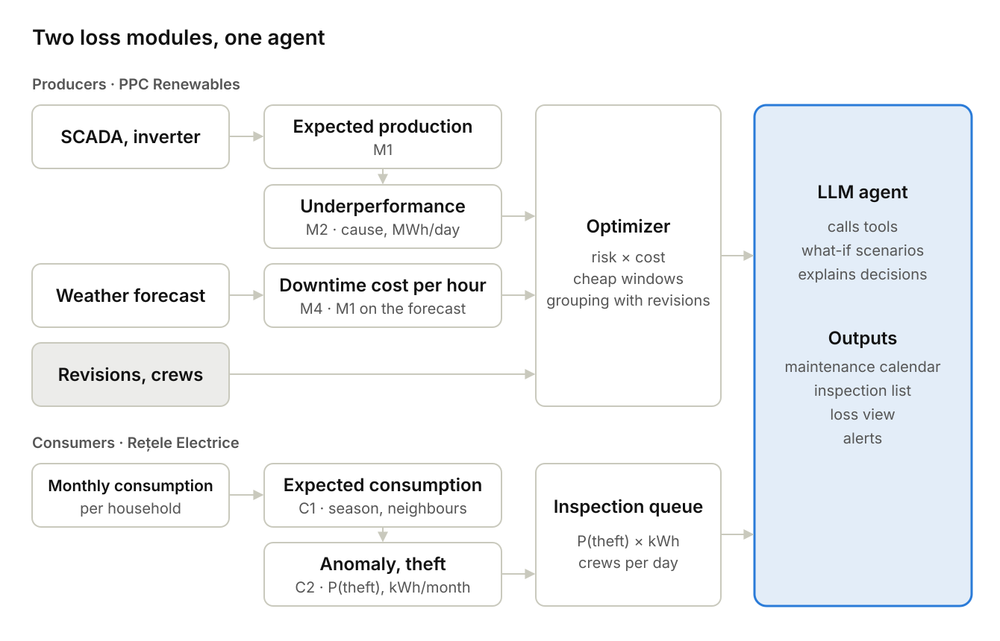
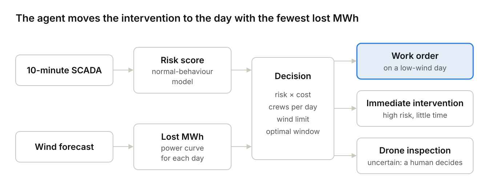

# Design: the energy loss agent

7 November 2026 · Valentin

> This document explains **why** the system is designed this way. Exact build specs (features, parameters, formulas, schemas) are in [`CLAUDE.md`](../CLAUDE.md); the public overview, data licences and results are in the [README](../README.md).

## In short

The agent has two loss modules and one shared agent layer. Each model answers one question, in one physical unit (kW, MWh, kWh, probability). Decisions are made by the optimizer and the prioritisation rules; the LLM only coordinates and explains.

| Component | Module | The question it answers | Output |
| --- | --- | --- | --- |
| M1 — expected production | Producers | How much should the turbine or inverter produce right now, if everything were fine? | Expected kW, with a confidence interval |
| M2 — underperformance | Producers | Is it producing less than it should? Why, and how much does it lose per day? | Probable cause + MWh lost per day |
| M3 — failure risk (optional) | Producers | How likely is it to break down in the coming days? | Failure probability over a horizon |
| M4 — downtime cost | Producers | If I stop it in hour X, how much do I lose? | MWh (or RON) for each hour of the coming days |
| Optimizer | Producers | Which revisions and checks do I do, where and on which day? | Maintenance calendar |
| C1 — expected consumption | Consumers | How much should the household consume this month? | Expected kWh per month, with an interval |
| C2 — consumption anomaly | Consumers | Does the monthly series look like theft or a faulty meter? How much is lost? | Theft probability + kWh lost per month |
| Inspection queue | Consumers | Which households get checked first, with the crews available? | Daily inspection list |
| LLM agent | Shared | What do I do today, why, and what happens if I change something? | Single view of losses, explanations, scenarios |

M1 and M4 are the same model used twice: once on current data, to see whether the equipment underperforms, and once on the weather forecast, to say what stopping costs in each hour. Symmetrically, for consumers, C1 says how much should be consumed and C2 measures the deviation from that.

## Agent diagram

*Agent diagram · 2 loss modules, 1 shared agent*

For producers, M1 is the foundation: M2 compares it with real production, and M4 applies it to the forecast. For consumers, C1 says how much should be consumed and C2 measures the deviation. The optimizer and the inspection queue make the decisions; the LLM agent coordinates and explains them. M3 (failure risk, optional) also feeds the optimizer.

## M1 — expected production

The model represents the "healthy version" of each turbine and inverter: what it would produce under current conditions if it had no problems. The rest of the agent rests on it.

| | Wind | Photovoltaic |
| --- | --- | --- |
| Predicts | Turbine active power, at 10 minutes | Inverter AC power, at 15 minutes |
| Trained on | Normal periods only: turbine running, no curtailment, no active alarms | Only days with no known faults, right after cleaning or rain |

**Why quantiles:** the mean alone does not say how sure the model is. If real production stays below the 10% quantile for several hours in a row, that is a signal; if the interval is very wide (turbulent wind, passing clouds), the agent knows not to draw conclusions.

**The main trap:** train on periods with faults and the model learns the fault as normal. The status and alarm filter is essential and must be described in the README.

## M2 — underperformance

The model says whether equipment produces systematically below M1, why, and how many MWh it loses per day. The stakes are real: up to 3% of wind farm production can be lost through turbines that run, but not as well as they should. A 3-degree yaw misalignment can reduce production by 1% ([GreenPowerMonitor, DNV](https://greenpowermonitor.com/?p=3368)).

**How it detects:**

1. **Performance index:** real production divided by expected, over a sliding window. At 1.0 all is normal; at 0.9, 10% is being lost.
2. **Change detection:** a CUSUM test on the deviations flags when the drop is persistent, not just one bad hour.
3. **Probable cause:** a small classifier on the shape of the deviation: in which wind range or at what time it appears, whether it appeared abruptly or gradually, how it compares with neighbours. It is trained on faults injected in a controlled way into real data ([`CLAUDE.md`](../CLAUDE.md) 9.2).

**The signatures it looks for:**

| Technology | Cause | How it looks in the data |
| --- | --- | --- |
| Wind | Yaw misalignment | Almost constant loss below rated power, appearing abruptly |
| Wind | Pitch fault | The turbine no longer reaches rated power; blade angle differs from normal at the same wind |
| Wind | Faulty anemometer | The power curve looks shifted, but production is normal compared with neighbouring turbines |
| Wind | Icing | Loss at temperatures around 0 °C and high humidity, disappearing when it warms up |
| Wind | Imposed curtailment (grid or noise) | Power capped at a fixed value, with a status code. Not a fault: the agent must exclude it, not send the crew |
| PV | Soiling | Slow decline, day after day, recovering after rain |
| PV | String outage | Abrupt step equal to that string's share of the inverter |
| PV | Shading or vegetation | Loss at the same hours every day, growing over time |
| PV | Derated or stopped inverter | Fixed cap or zero while the sun is out |

**Output:** for each asset, the loss rate (MWh per day), the most probable cause with its probability, and the confidence. The loss rate is essential for the decision: it is the cost of each day you do not intervene.

## M3 — failure risk (optional)

The model says how long until something breaks down properly. The difference from M2: there, the turbine loses production now; here, it still produces normally but shows signs it will stop. No mechanical knowledge is needed: faults show up in the data as temperatures too high for the current load.

Two options, pick one ([`CLAUDE.md`](../CLAUDE.md) 9.4):

1. **Abnormal temperatures (on CARE to Compare).** A normal-behaviour model predicts bearing, oil and generator temperature; the smoothed deviation becomes the risk score.
2. **Alarm prediction (on Hill of Towie).** A classifier predicts whether the turbine will have a serious alarm or downtime in the next 7 days.

**Output:** failure probability for each day of the horizon. For the optimizer this becomes a soft deadline: the longer you wait, the higher the risk of a long, expensive stop.

If time is short, skip this model. The agent also works with just periodic revisions and M2.

## M4 — the cost of stopping in each hour

This is the core idea: maintain turbines when the wind is not blowing and panels when the sun is not shining. For each asset and each hour of the next 7–10 days, it calculates what would be lost if the asset were stopped then: the expected production for that hour.

**What the result represents:** a "cost map" of asset × hour. For wind, calm days appear as deep valleys. For PV, nights cost zero and cloudy days little. Some PV jobs still need natural light, so each job type has its own allowed hours.

**Price:** multiplied by an estimated hourly energy price, the cost becomes RON, and hours with very low or negative prices become almost free for maintenance. We have not verified the terms of use for OPCOM or ENTSO-E price data, so check them before relying on them.

**Forecast uncertainty:** the forecast gets less precise with each extra day. Use M1's quantiles and, if available, several weather scenarios. The agent re-plans daily with the new forecast, so a good day seen today 6 days out remains only an option until it gets closer.

## The decision layer

The optimizer receives a list of jobs and picks the day and crew for each, so that total cost is minimal. It re-plans every morning with the new forecast and detections.

**Job types:**

| Job | Where it comes from | What the agent knows about it |
| --- | --- | --- |
| Periodic revision | The service calendar (usually every 6 months; the annual one lasts 2–4 days, per [an RES O&M plan](https://archives.bape.gouv.qc.ca/sections/mandats/eole-valleau-sables/documents/sables/PR3-3-annF.pdf)) | Due date, a tolerance window (parameter) and duration |
| Repair for underperformance | M2 | Loss rate per day, probable cause, estimated duration |
| Preventive intervention | M3 | How failure risk grows with each day of waiting |
| Remote or drone check | Any low-confidence case | Short duration, does not stop the asset |

**The cost of a job on day d** is the sum of three things: the downtime (from M4), the loss while waiting (from M2) and the risk (from M3). Formula and constraints: [`CLAUDE.md`](../CLAUDE.md) 9.6.

**Grouping with the revision:** if a problem turbine has a revision due within the planning window, the agent compares "repair now" with "repair at revision". The second option costs no separate stop, only the loss while waiting.

**Example (illustrative figures):** a 2.5 MW turbine produces on average approx. 14 MWh per day (1.25 TWh per year across the 240 turbines at [Fântânele-Cogealac](https://www.economica.net/ppc-pune-o-baterie-de-91-mwh-la-un-parc-eolian-din-dobrogea_961423.html/amp)). M2 detects a pitch fault: performance index 0.9, so it loses approx. 1.4 MWh per day. The repair takes 8 hours.

| Option | Downtime (M4) | Loss while waiting | Total |
| --- | --- | --- | --- |
| Tomorrow, strong wind forecast | 18 MWh | 1 day × 1.4 = 1.4 MWh | 19.4 MWh |
| In 4 days, low wind forecast | 2 MWh | 4 days × 1.4 = 5.6 MWh | **7.6 MWh** |

The agent picks the calm day and explains why, with the figures above. If M3 showed a high failure risk in the coming days, the risk term would tip the decision towards "tomorrow".

*Simplified view of one wind intervention and its three possible outcomes. In the full design, the risk score is the optional M3 and the lost MWh come from M4.*

**"I'm not sure":** if M2's confidence is low or the forecast is very uncertain on the candidate days, the agent does not schedule a crew. It first schedules a remote or drone check and asks an engineer to confirm.

## The consumers module: anomalies in monthly consumption

For each household, the module receives consumption over consecutive months and looks for series that look like theft or a faulty meter. The output is in kWh lost and probability, so it joins the same view as producer losses.

**Input:** a monthly series per household (for example 24–36 months) and, where available, attributes: area or transformer station, housing type, whether it is a prosumer. On public data, monthly series are obtained by aggregating daily data.

**C1 — expected consumption:** how much the household should consume in a month, from:

- its own history for the same month and its trend;
- consumption of similar households (grouped by the shape of the annual profile);
- mean monthly temperature.

Algorithm: quantile LightGBM. Baseline: median of the same month in previous years, multiplied by a trend factor.

**C2 — the anomaly:**

- **Signals:** real/expected ratio over recent months; an abrupt and persistent drop; months with zero or identical values; deviation from the group of similar households; disappearance of seasonality (for example winter consumption); abnormally low variability.
- **Two-level model:** an unsupervised detector (Isolation Forest) for series without labels and a supervised classifier (LightGBM) trained on real labels (SGCC) and simulated attacks. Probabilities are calibrated.
- **Outputs:** theft probability; kWh lost per month = max(0, expected − real); signal type: probable theft, probable faulty meter or uncertain.

**The decision — the inspection queue:** the value of an inspection = theft probability × kWh lost per month × recoverable months − travel cost. The agent picks the top K households per day for each crew and groups them geographically. Probably faulty meters go to the metering team, and uncertain cases to a remote check. The agent does not declare anyone a thief: it schedules checks.

**Data:**

| Dataset | Contents | How to use it |
| --- | --- | --- |
| [SGCC](https://baselight.app/u/kaggle/dataset/bensalem14_sgcc_dataset) (Kaggle) | 42,372 customers, daily consumption 1 Jan 2014 – 30 Oct 2016, FLAG label (theft = 1, approx. 8.5%) | Aggregated monthly (approx. 34 months): supervised training and testing. Has many missing values |
| [Smart Meters in London](https://www.kaggle.com/datasets/jeanmidev/smart-meters-in-london) (Kaggle) | 30-minute consumption for thousands of households | Aggregated monthly, with attacks simulated using the classic functions from the literature ([arXiv](https://arxiv.org/pdf/2010.09212)) |
| [London synthetic set](https://ieee-dataport.org/node/14900) (IEEE DataPort) | 159 users, 7 attack strategies applied in the last month | Quick check of the detector |

**Evaluation:** split by customer (no customer in both train and test) and by time. Metrics: PR-AUC, precision in the top K (K = inspection capacity), kWh recovered in the top K. Baseline: the rule "consumption more than X% below the same month last year" and Isolation Forest alone.

**Error analysis worth showing:**

- **Monthly granularity:** attacks that only shift consumption between hours do not change the monthly total, so they are invisible at month level. This is an honest limit and an argument for smart-meter data: Rețele Electrice has 2 million meters.
- **New prosumers:** after installing panels, net consumption from the grid drops abruptly and looks exactly like theft. With over 359,000 prosumers in Romania, the attribute "prosumer since month X" is essential to avoid false alarms.
- **Holiday homes and empty dwellings:** seasonal or near-zero consumption, legitimately.

## The shared agent layer

The LLM sits above the two modules, calls tools and explains results. Any change of plan goes through the optimizer or the inspection queue. Tools are listed in the [README](../README.md#33-llm-agent). The agent's architecture (pipeline, tool contracts, confirmation gate, grounding check, security, UI) is designed in the OpenSpec change [`add-llm-agent`](../openspec/changes/add-llm-agent/design.md).

**The single view of losses:** a table of losses by source, in MWh and RON (the price is a parameter):

- producers: MWh lost from underperformance and from scheduled downtime;
- consumers: kWh per month estimated as lost at suspect households.

Each row links to the prediction that produced it, so the decision can be traced end to end.

**Demo scenarios beyond the producers ones** ([`CLAUDE.md`](../CLAUDE.md) 10.4):

1. "What losses do we have this week?" → `loss_overview`: producers and consumers, in MWh and RON.
2. "Why is household X on today's list?" → `explain`: the monthly curve against expectation and neighbours, the 3 most important reasons.
3. "I checked household X: faulty meter, not theft." → `update_from_field_report` → confirmation → the case closes, and the label enters the retraining data.
