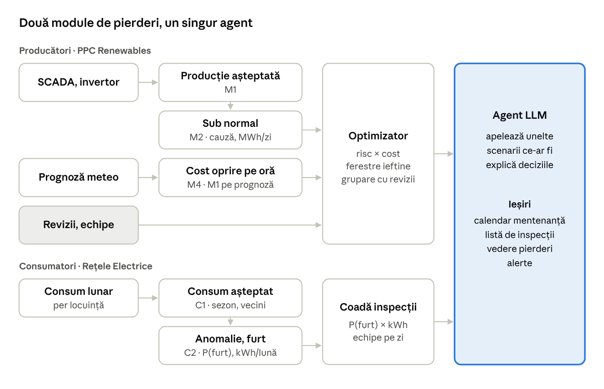

# Design: agentul pentru pierderile de energie

7 noiembrie 2026 · Valentin

> Exportat din documentul de lucru al echipei (Claude Doc) pe 7 noiembrie 2026. Sursa de adevăr pentru implementare rămâne README-ul.


## Pe scurt

Agentul are două module de pierderi și un strat agentic comun. Fiecare model răspunde la o singură întrebare, într-o unitate fizică (kW, MWh, kWh, probabilitate). Deciziile le iau optimizatorul și regulile de prioritizare, iar LLM-ul doar coordonează și explică.

| Piesă | Modul | Întrebarea la care răspunde | Ce scoate |
| --- | --- | --- | --- |
| M1 — producția așteptată | Producători | Cât ar trebui să producă turbina sau invertorul acum, dacă totul ar fi în regulă? | kW așteptați, cu interval de încredere |
| M2 — funcționare suboptimală | Producători | Produce mai puțin decât ar trebui? De ce, și cât pierde pe zi? | Cauza probabilă + MWh pierduți pe zi |
| M3 — riscul de defect (opțional) | Producători | Cât de probabil e să se strice în zilele următoare? | Probabilitate de defect pe orizont |
| M4 — costul opririi | Producători | Dacă îl opresc în ora X, cât pierd? | MWh (sau lei) pentru fiecare oră din zilele următoare |
| Optimizator | Producători | Ce revizii și controale fac, unde și în ce zi? | Calendar de mentenanță |
| C1 — consumul așteptat | Consumatori | Cât ar trebui să consume locuința în luna asta? | kWh așteptați pe lună, cu interval |
| C2 — anomalie de consum | Consumatori | Seria lunară arată a furt sau a contor defect? Cât se pierde? | Probabilitate de furt + kWh pierduți pe lună |
| Coada de inspecții | Consumatori | Ce locuințe se verifică primele, cu echipele disponibile? | Listă zilnică de inspecții |
| Agentul LLM | Comun | Ce fac azi, de ce, și ce se întâmplă dacă schimb ceva? | Vedere unică a pierderilor, explicații, scenarii |

Modelele 1 și 4 sunt același model folosit de două ori: o dată pe datele de acum, ca să vadă dacă echipamentul produce sub normal, și o dată pe prognoza meteo, ca să spună cât costă oprirea în fiecare oră. Simetric, la consumatori, C1 spune cât ar trebui consumat, iar C2 măsoară abaterea de la așteptare.

## Schema agentului



*Schema agentului · 2 module de pierderi, 1 agent comun*

La producători, modelul 1 e baza: modelul 2 îl compară cu producția reală, iar modelul 4 îl aplică pe prognoză. La consumatori, C1 spune cât ar trebui consumat, iar C2 măsoară abaterea. Optimizatorul și coada de inspecții iau deciziile; agentul LLM le coordonează și le explică. Modelul 3 (riscul de defect, opțional) intră tot în optimizator.

## Modelul 1 — producția așteptată

Modelul reprezintă „versiunea sănătoasă” a fiecărei turbine și a fiecărui invertor: cât ar produce în condițiile de acum dacă nu ar avea nicio problemă. Tot restul agentului se sprijină pe el.

|  | Eolian | Fotovoltaic |
| --- | --- | --- |
| Ce prezice | Puterea activă a turbinei, la 10 minute | Puterea AC a invertorului, la 15 minute |
| Intrări | Viteza vântului, densitatea aerului (din temperatură și presiune), direcția vântului, turbulența (deviația standard a vântului în interval), ora | Iradianța, temperatura modulului, unghiul soarelui (calculat cu pvlib), ora |
| Pe ce date se antrenează | Doar perioade normale: turbina în funcțiune, fără limitări, fără alarme active | Doar zile fără defecte cunoscute, imediat după curățare sau ploaie |
| Algoritm | LightGBM cu regresie pe cuantile (10%, 50%, 90%), un model per turbină sau per tip de turbină | Același, per invertor |
| Baseline | Curba de putere clasică: media puterii pe intervale de 0,5 m/s de vânt | Puterea nominală × iradianța / 1000 × o corecție de temperatură |

**De ce cuantile:** media singură nu spune cât de sigur e modelul. Dacă producția reală stă sub cuantila de 10% mai multe ore la rând, e un semnal; dacă intervalul e foarte larg (vânt turbulent, nori trecători), agentul știe să nu tragă concluzii.

**Capcana principală:** dacă antrenați pe perioade cu defecte, modelul învață defectul ca normal. Filtrul pe status și pe alarme e esențial și trebuie descris în README.

## Modelul 2 — funcționare suboptimală

Modelul spune dacă un echipament produce sistematic sub modelul 1, de ce, și câți MWh pierde pe zi. Miza e reală: până la 3% din producția parcurilor eoliene se poate pierde prin turbine care merg, dar nu cât ar trebui. O abatere de direcție de 3 grade poate reduce producția cu 1% ([GreenPowerMonitor, DNV](https://greenpowermonitor.com/?p=3368)).

**Cum detectează:**

1.  **Indicele de performanță:** producția reală împărțită la cea așteptată, pe o fereastră glisantă (de exemplu 3 zile). La 1,0 totul e normal; la 0,9 se pierde 10%.

2.  **Detecția schimbării:** un test CUSUM pe abateri semnalează când scăderea e persistentă, nu doar o oră proastă.

3.  **Cauza probabilă:** un clasificator mic (LightGBM) pe forma abaterii: în ce zonă de vânt sau la ce oră apare, dacă a apărut brusc sau treptat, cum arată față de vecini. Se antrenează pe defecte injectate controlat în date reale.

**Semnăturile pe care le caută:**

| Tehnologie | Cauză | Cum arată în date | Cum o injectați pentru antrenare |
| --- | --- | --- | --- |
| Eolian | Abatere de direcție (yaw) | Pierdere aproape constantă sub puterea nominală, apărută brusc | Înmulțiți puterea cu un factor dependent de unghi (o aproximare des folosită: cos² al unghiului) |
| Eolian | Problemă de pitch | Turbina nu mai atinge puterea nominală; unghiul palelor diferă de normal la același vânt | Plafonați puterea sub nominal în zona de vânt mare |
| Eolian | Anemometru defect | Curba de putere pare deplasată, dar producția e normală față de turbinele vecine | Scalați viteza măsurată cu ±5–10%, lăsați puterea neschimbată |
| Eolian | Givraj | Pierdere la temperaturi în jur de 0 °C și umiditate mare, dispare când se încălzește | Reduceți puterea doar în orele reci și umede |
| Eolian | Limitare impusă (de rețea sau de zgomot) | Putere plafonată la o valoare fixă, cu cod de status | Nu e defect: agentul trebuie să o excludă, nu să trimită echipa |
| PV | Murdărire | Scădere lentă, zi de zi, care revine după ploaie | Pantă descrescătoare resetată în zilele cu precipitații |
| PV | String căzut | Treaptă bruscă egală cu partea acelui string din invertor | Scădeți brusc 1/N din putere (N = numărul de stringuri) |
| PV | Umbrire sau vegetație | Pierdere la aceleași ore în fiecare zi, care crește în timp | Reducere doar într-un interval orar, tot mai mare de la o săptămână la alta |
| PV | Invertor limitat sau oprit | Plafon fix sau zero cât timp e soare | Plafonați sau anulați puterea unui invertor |

**Ce scoate:** pentru fiecare echipament, rata de pierdere (MWh pe zi), cauza cea mai probabilă cu probabilitatea ei, și încrederea. Rata de pierdere e esențială pentru decizie: e costul fiecărei zile în care nu interveniți.

## Modelul 3 — riscul de defect (opțional)

Modelul spune cât timp mai ai până când ceva se strică de-a binelea. Diferența față de modelul 2: acolo turbina pierde producție acum; aici încă produce normal, dar dă semne că se va opri. Nu aveți nevoie de cunoștințe mecanice: defectele apar în date ca temperaturi prea mari pentru încărcarea de moment.

Două variante, alegeți una:

1.  **Temperaturi anormale (pe CARE to Compare).** Un model de comportament normal prezice temperatura rulmenților, a uleiului și a generatorului din putere, turație și temperatura exterioară. Abaterea netezită devine scor de risc. Pragul se alege pe set de validare, ca să limiteze alarmele false pe turbină pe lună. Evaluare: scorul CARE.

2.  **Predicția alarmelor (pe Hill of Towie).** Un clasificator prezice dacă turbina va avea o alarmă gravă sau o oprire în următoarele 7 zile, din statistici pe ultimele zile: abateri de temperatură, numărul de alarme minore, indicele de performanță din modelul 2. Evaluare: precizie și recall pe perioade de test separate în timp.

**Ce scoate:** probabilitatea de defect pentru fiecare zi din orizont (de exemplu 1–14 zile). Pentru optimizator asta devine un termen limită flexibil: cu cât aștepți mai mult, cu atât crește riscul unei opriri lungi și scumpe.

Dacă nu aveți timp, săriți peste acest model. Agentul funcționează și doar cu reviziile periodice și cu modelul 2.

## Modelul 4 — costul opririi în fiecare oră

Acesta e modelul care răspunde direct la ideea ta: „mentenanța la eoliene când nu bate vântul, la panouri când nu e soare”. Pentru fiecare echipament și fiecare oră din următoarele 7–10 zile, calculează cât s-ar pierde dacă echipamentul ar fi oprit atunci.

**Cum se calculează:**

1.  Luați prognoza meteo orară pentru coordonatele parcului: vânt, temperatură, presiune pentru eoliene; iradianță și temperatură pentru PV.

2.  Treceți-o prin modelul 1. Rezultatul e producția așteptată în fiecare oră, adică exact ce s-ar pierde dacă echipamentul ar fi oprit.

3.  Opțional, înmulțiți cu prețul orar estimat al energiei. Așa costul devine în lei, iar orele cu preț foarte mic sau negativ devin aproape gratuite pentru mentenanță.

4.  Marcați orele în care nu se poate lucra deloc: vânt peste limita de siguranță pentru urcat în turbină, furtună, ploaie puternică. Limitele vin din manualul producătorului; în proiect sunt parametri configurabili.

**Ce reprezintă rezultatul:** o „hartă de cost” echipament × oră. La eoliene, zilele calme apar ca văi adinci. La PV, nopțile costă zero, iar zilele noroase puțin. Unele lucrări PV au totuși nevoie de lumină naturală, deci fiecare tip de lucrare are propriile ore permise.

**Incertitudinea prognozei:** prognoza devine mai puțin precisă cu fiecare zi în plus. Folosiți cuantilele modelului 1 și, dacă aveți, mai multe scenarii meteo. Agentul re-planifică zilnic cu prognoza nouă, deci o zi bună văzută azi la 6 zile distanță rămâne doar o opțiune până se apropie.

## Stratul de decizie

Optimizatorul primește o listă de lucrări și alege pentru fiecare ziua și echipa, astfel încât costul total să fie minim. Re-planifică în fiecare dimineață, cu prognoza și detecțiile noi.

**Tipurile de lucrări:**

| Lucrare | De unde vine | Ce știe agentul despre ea |
| --- | --- | --- |
| Revizie periodică | Calendarul de service (de obicei la 6 luni; cea anuală durează 2–4 zile, conform [unui plan de O&M RES](https://archives.bape.gouv.qc.ca/sections/mandats/eole-valleau-sables/documents/sables/PR3-3-annF.pdf)) | Data scadentă, o fereastră de toleranță (parametru) și durata |
| Reparație pentru funcționare suboptimală | Modelul 2 | Rata de pierdere pe zi, cauza probabilă, durata estimată |
| Intervenție preventivă | Modelul 3 | Cum crește riscul de defect cu fiecare zi de așteptare |
| Verificare la distanță sau cu drona | Orice caz cu încredere mică | Durată scurtă, nu oprește echipamentul |

**Costul unei lucrări programate în ziua d:**

```math
C(d) = \underbrace{\sum_{h \in \text{lucru}} P_{\text{așteptat}}(h)}_{\text{oprirea, din modelul 4}} + \underbrace{L \cdot (d - \text{azi})}_{\text{pierderea cât aștepți, din modelul 2}} + \underbrace{p_{\text{defect}}(d) \cdot C_{\text{defect}}}_{\text{riscul, din modelul 3}}
```

**Constrângeri:** numărul de echipe pe zi și orele lor, orele în care se poate lucra (vânt, furtună), fereastra de toleranță a reviziilor, o singură echipă pe turbină, și deplasările: lucrările din același parc se grupează în aceeași zi.

**Gruparea cu revizia:** dacă o turbină cu problemă are revizia scadentă în fereastra de planificare, agentul compară „repar acum” cu „repar la revizie”. A doua variantă nu mai costă o oprire separată, doar pierderea din așteptare.

**Exemplu (cifre ilustrative):** o turbină de 2,5 MW produce în medie aprox. 14 MWh pe zi. Modelul 2 detectează o problemă de pitch: indicele de performanță 0,9, deci pierde aprox. 1,4 MWh pe zi. Reparația durează 8 ore.

| Variantă | Oprirea (modelul 4) | Pierderea cât aștepți | Total |
| --- | --- | --- | --- |
| Mâine, prognoză cu vânt puternic | 18 MWh | 1 zi × 1,4 = 1,4 MWh | 19,4 MWh |
| Peste 4 zile, prognoză cu vânt slab | 2 MWh | 4 zile × 1,4 = 5,6 MWh | **7,6 MWh** |

Agentul alege ziua calmă și explică de ce, cu cifrele de mai sus. Dacă modelul 3 ar arăta risc mare de defect în următoarele zile, termenul de risc ar răsturna decizia spre „mâine”.

**Algoritm în 24h:** un algoritm lacom (greedy) e suficient: sortați lucrările după urgență și alegeți pentru fiecare cea mai ieftină zi liberă. Dacă aveți timp, înlocuiți-l cu un model mic de optimizare (OR-Tools sau PuLP) și arătați cât câștigați față de greedy.

**„Nu sunt sigur”:** dacă încrederea modelului 2 e mică sau prognoza e foarte incertă în zilele candidate, agentul nu programează o echipă. Programează întâi o verificare la distanță sau cu drona și cere confirmarea unui inginer.

## Modulul consumatori: anomalii în consumul lunar

Pentru fiecare locuință, modulul primește consumul pe luni consecutive și caută seriile care arată a furt sau a contor defect. Ieșirea e în kWh pierduți și probabilitate, ca să intre în aceeași vedere cu pierderile de la producători.

**Intrarea:** o serie lunară per locuință (de exemplu 24–36 de luni) și, unde există, atribute: zona sau postul de transformare, tipul de locuință, dacă e prosumator. Pe datele publice, seriile lunare se obțin prin agregarea datelor zilnice.

**C1 — consumul așteptat:** cât ar trebui să consume locuința într-o lună, din:

- propriul istoric pe aceeași lună și tendința ei;

- consumul locuințelor similare (grupate după forma profilului anual);

- temperatura medie lunară.

Algoritm: LightGBM cu cuantile. Baseline: mediana aceleiași luni din anii anteriori, înmulțită cu un factor de tendință.

**C2 — anomalia:**

- **Semnale:** raportul real/așteptat pe ultimele luni; o scădere bruscă și persistentă; luni cu zero sau cu valori identice; abaterea față de grupul de locuințe similare; dispariția sezonalității (de exemplu consumul de iarnă); variabilitate anormal de mică.

- **Model pe două niveluri:** un detector nesupravegheat (Isolation Forest) pentru serii fără etichete și un clasificator supravegheat (LightGBM) antrenat pe etichete reale (SGCC) și pe atacuri simulate. Probabilitățile se calibrează.

- **Ieșiri:** probabilitatea de furt; kWh pierduți pe lună = max(0, așteptat − real); tipul semnalului: furt probabil, contor defect probabil sau nesigur.

**Decizia — coada de inspecții:** valoarea unei inspecții = probabilitatea de furt × kWh pierduți pe lună × lunile recuperabile − costul deplasării. Agentul alege primele K locuințe pe zi pentru fiecare echipă și le grupează geografic. Contoarele probabil defecte merg la echipa de măsură, iar cazurile nesigure la o verificare de la distanță. Agentul nu declară pe nimeni hoț: programează verificări.

**Date:**

| Set | Conținut | Cum îl folosiți |
| --- | --- | --- |
| [SGCC](https://baselight.app/u/kaggle/dataset/bensalem14_sgcc_dataset) (Kaggle) | 42.372 de clienți, consum zilnic 1 ian. 2014 – 30 oct. 2016, eticheta FLAG (furt = 1, aprox. 8,5%) | Agregat lunar (aprox. 34 de luni): antrenare și test supravegheat. Are multe valori lipsă |
| [Smart Meters in London](https://www.kaggle.com/datasets/jeanmidev/smart-meters-in-london) (Kaggle) | Consum la 30 de minute pentru mii de gospodării | Agregat lunar, cu atacuri simulate după funcțiile clasice din literatură ([arXiv](https://arxiv.org/pdf/2010.09212)) |
| [Set sintetic London](https://ieee-dataport.org/node/14900) (IEEE DataPort) | 159 de utilizatori, 7 strategii de atac aplicate în ultima lună | Verificare rapidă a detectorului |

**Evaluare:** împărțire după client (niciun client în train și în test) și după timp. Metrici: PR-AUC, precizia în primele K (K = capacitatea de inspecție), kWh recuperați în primele K. Baseline: regula „consum cu peste X% sub aceeași lună de anul trecut” și Isolation Forest singur.

**Analiza erorilor pe care o merită arătată:**

- **Granularitatea lunară:** atacurile care doar mută consumul între ore nu schimbă totalul lunar, deci sunt invizibile la nivel de lună. E o limită cinstită și un argument pentru datele de la contoarele inteligente: Rețele Electrice are 2 milioane.

- **Prosumatorii noi:** după montarea panourilor, consumul net din rețea scade brusc și arată exact ca un furt. Cu peste 359.000 de prosumatori în România, atributul „prosumator din luna X” e esențial ca să evitați falsele alarme.

- **Case de vacanță și locuințe goale:** consum sezonier sau aproape zero, legitim.

## Stratul agentic comun

LLM-ul stă peste cele două module, apelează unelte și explică rezultatele. Nu calculează și nu decide singur: orice număr vine dintr-o unealtă, iar orice schimbare de plan trece prin optimizator sau prin coada de inspecții.

**Vederea unică a pierderilor:** un tabel cu pierderile pe sursă, în MWh și în lei (prețul e parametru):

- producători: MWh pierduți din funcționare sub normal și din opririle programate;

- consumatori: kWh pe lună estimați ca pierduți la locuințele suspecte.

Fiecare rând are legătură cu predicția care l-a produs, deci decizia se poate urmări cap-coadă.

**Unelte:**

| Modul | Unelte |
| --- | --- |
| Producători | get_weather_forecast, predict_expected_production, detect_underperformance, compute_cost_map, optimize_maintenance |
| Consumatori | predict_expected_consumption, score_households, build_inspection_list |
| Comune | loss_overview, explain(item_id), update_from_field_report(text), create_work_orders, send_alert |

**Scenarii de demo:**

1.  „Ce pierderi avem săptămâna asta?” → loss_overview: producători și consumatori, în MWh și lei.

2.  „De ce turbina T17 vineri și nu mâine?” → explain cu tabelul de variante.

3.  „Echipa 2 lipsește joi.” → optimize_maintenance cu constrângerea nouă și diferența de cost.

4.  „De ce e locuința X pe lista de azi?” → explain: curba lunară față de așteptare și de vecini, cele mai importante 3 motive.

5.  „Am verificat locuința X: contor defect, nu furt.” → update_from_field_report → confirmare → cazul se închide, iar eticheta intră în datele de reantrenare.

## Evaluare și demo

Cel mai convingător rezultat e o reluare a unui an întreg de date, în care comparați MWh pierduți de agent cu MWh pierduți de două politici simple.

| Piesă | Cum o evaluați | Baseline |
| --- | --- | --- |
| Modelul 1 | Eroarea medie (kW) și acoperirea intervalului 10–90% pe date de test separate în timp | Curba de putere pe intervale de vânt |
| Modelul 2 | Pe defecte injectate în perioada de test: câte sunt prinse, în câte zile, câte alarme false pe lună, acuratețea cauzei | Prag fix pe indicele de performanță |
| Modelul 3 | Scorul CARE (pe CARE to Compare) sau precizie/recall pe 7 zile (pe Hill of Towie) | Prag fix pe temperatură; EnergyFaultDetector |
| Agentul întreg | Reluarea unui an: MWh pierduți din opriri + MWh pierduți din așteptare | \(a\) intervenție imediată, fără a privi vremea; (b) totul la revizia următoare |

**Reluarea anului (backtest):** luați un an de date Kelmarsh sau Hill of Towie. Injectați câteva zeci de probleme la date aleatoare și generați un calendar de revizii la 6 luni. Agentul rulează zi cu zi, văzând doar datele de până atunci; folosiți vremea reală din ziua următoare ca „prognoză perfectă” și, separat, o prognoză cu zgomot, ca să fieți cinstiți. La final comparați cele trei politici într-un singur grafic.

**Demo-ul live, în 3 minute:**

1.  Harta parcului cu turbinele colorate după indicele de performanță.

2.  Click pe o turbină: producția reală sub banda așteptată, cauza probabilă și MWh pierduți pe zi.

3.  „Harta de cost” pentru următoarele 7 zile, cu văile zilelor calme.

4.  Calendarul generat, cu explicația fiecărei alegeri (tabelul de variante de mai sus).

5.  Graficul reluării anului: agentul vs. cele două politici simple.

## Ce date folosește fiecare model

Toate seturile sunt descrise, cu licența lor, în [analiza de piață, anexa „Mentenanță eolian și PV”](analiza-piata.md#anexă-mentenanță-eolian-și-pv--date-disponibile-și-soluții-existente).

| Piesă | Eolian | Fotovoltaic |
| --- | --- | --- |
| Modelul 1 — producția așteptată | Kelmarsh sau Hill of Towie (SCADA la 10 minute, cu status pentru filtrare) | Solar Power Generation Data (pe invertor) sau PVDAQ |
| Modelul 2 — funcționare suboptimală | Aceleași date, cu defecte injectate; upgrade-urile de la Hill of Towie ca schimbări reale de performanță | Aceleași date, cu murdărire, stringuri căzute și umbrire injectate |
| Modelul 3 — riscul de defect | CARE to Compare (defecte etichetate) sau jurnalul de alarme Hill of Towie | Opțional: PVF-10 pentru imagini termice |
| Modelul 4 — costul opririi | Modelul 1 + prognoză meteo orară pentru coordonatele parcurilor din Dobrogea | Modelul 1 + prognoză de iradianță |
| Optimizatorul | Calendar de revizii generat (la 6 luni), număr de echipe și limite de vânt ca parametri | Aceleași |

Datele modulului de consumatori (SGCC, Smart Meters in London, setul sintetic de pe IEEE DataPort) sunt descrise în secțiunea „Modulul consumatori: anomalii în consumul lunar”.

Pentru vreme și prețuri pe România (Open-Meteo, OPCOM, ENTSO-E), verificați termenii de utilizare înainte de hackathon; nu i-am verificat aici.
